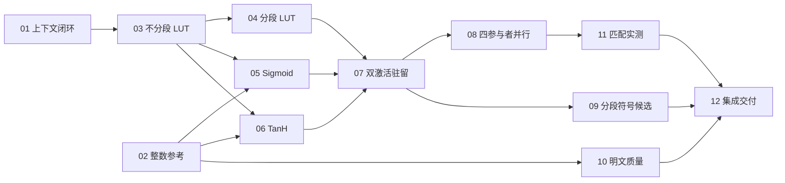

# 完整论文激活替换：工单拆分与发布索引

**日期:** 2026-10-13

**状态:** published; implementation-started

**来源:** [完整方案](spec.md)，包含用户补充的完整 10-bit 不分段 DPF 必测要求。

用户于 2026-10-13 调用 implement-spec，授权实施上述工单并报告 LAN/WAN 下与 SCI/SiRNN 的两阶段成本对照。12 张工单按一票一文件发布，应用 `ready-for-agent` 状态和标签。依赖关系按本清单执行。

## 拆分清单

| 编号 | 工单 | 直接阻塞 | 独立交付 |
| --- | --- | --- | --- |
| 01 | [显式上下文下的完整 Q12 激活](issues/01-context-isolated-activation.md) | 无 | 现有完整 folded 核在非默认上下文中真实执行，保留旧接口兼容，消除新路径的全局 peer 依赖。 |
| 02 | [冻结激活整数参考与整图回放](issues/02-folded-integer-oracle.md) | 无 | 原生全输入映射、公开表及明文单步/99 步回放可运行，SCI 与 folded 模式明确区分。 |
| 03 | [不分段 10-bit LUT 完整查询](issues/03-full-q-lut-lifecycle.md) | 01 | 不分段算术 DPF 完成输入前生成、驻留、开值、共享在线内积与一次消费。 |
| 04 | [两个 5-bit 段的 LUT 查询](issues/04-segmented-lut-lifecycle.md) | 03 | 分段构造生成同一布局的 one-hot，接入相同在线核，去掉全移位输出预计算。 |
| 05 | [完整 Sigmoid 替换与单步接入](issues/05-native-folded-sigmoid.md) | 02、03 | Q7 输入安全转 Q12，完整 folded Sigmoid 输出 Q14，独立通过全输入及单激活替换单步。 |
| 06 | [完整 TanH 替换与单步接入](issues/06-native-folded-tanh.md) | 02、03 | 宽环倍增与 signed floor 缩放正确，输出 Q7，独立通过全输入及单激活替换单步。 |
| 07 | [双激活 Batch=128 联合驻留](issues/07-batch128-joint-residency.md) | 04、05、06 | 两种 LUT 各自支持完整双激活单步，整数、内存、输入前材料和连续请求资格通过。 |
| 08 | [四参与者图并行与激活分片](issues/08-four-participant-parallelism.md) | 07 | 两种 LUT 均支持图并行和双 worker，保留线性/尾部并行，输出、资源与通信轨迹正确。 |
| 09 | [分段 FSS 符号测试候选](issues/09-segmented-sign-candidate.md) | 07 | 在完整激活及单步中替换两个符号测试，交付相对 BitDec 的整数核验和阶段成本。 |
| 10 | [冻结验证集的明文模型质量](issues/10-frozen-model-quality.md) | 02 | 完整 6798 条、99 步及分类头的质量结果与 1.0 个百分点门槛结论。 |
| 11 | [分段与不分段的匹配性能实测](issues/11-matched-lut-performance.md) | 08 | 两种构造各自串行/并行四行、必要调度归因和 SCI 对照，回答在线效率是否更高。 |
| 12 | [集成交付与推荐配置报告](issues/12-integrated-delivery-report.md) | 09、10、11 | 汇总功能、质量、资源和性能，交付实际可运行的具名配置及有证据的推荐结论。 |

## 依赖与实施

- 初始 frontier 为 01、02。02 完成后 10 可以立即执行；01 完成后启动 03；03 之后 04、05、06 可以并行，05/06 还需 02。07 汇合两种 LUT 与两种原生激活。
- 01 是必要的预重构，但以非默认上下文实际执行完整 Q12 激活为验收，不以新增接口为交付。它保持现有整数函数和查表约定；03 才落实新后端的 q=10 材料契约、统一减法开值和共享在线表示，避免两票重复实现同一功能。
- 01 采用向后兼容的增量改造：新增显式上下文调用形式，迁移本票涉及的完整调用链，保留旧串行转发接口。无需将整个代码库的历史调用者都迁移，也不强行删除兼容接口。
- 04 依赖 03 的可执行共享 LUT 契约。05 与 06 先用不分段构造打通原生调用，各自可以保持另一种激活为 SCI 并明确标记为局部替换诊断。07 才作为完整双激活后端验收，不把中间态冒充最终组合。
- 08 与 09 可在 07 后并行。09 的局部比较使用同一串行配置，不因尚未完成图并行而阻塞；最后并行集成在 12 核验。共享代码的协调不增加虚假的功能依赖。
- 11 固定 BitDec 做两种 LUT 的匹配实测，不等待 09 或 10。09 自己交付符号候选的局部阶段成本；10 自己交付模型质量。12 汇合三条支线并决定推荐资格。
- 协议计量、材料资格和必要正确性测试随产生行为的工单交付；11 不承担从零补建追踪基础设施。正式性能行按冻结顺序串行运行，并避开构建及其他重负载。
- 12 只列直接阻塞，01 至 08 的交付通过 09/11 传递。最终推荐需同时具备正确性、资源、质量和性能证据；调查结果为退化或质量未达标可据实交付，不能把失败改写为通过。

## 共同验收边界

- 原生输入 16-bit/Q7，内部 32-bit/Q12，LUT q=10；Sigmoid 输出 16-bit/Q14，TanH 输出 16-bit/Q7。TanH 最后除以 32 向负无穷取整。激活以外的图数值规则保持冻结。
- 两种 LUT 的输出均为同一表的共享查值。共同驻留格式为每元素 1024 项 32 位算术 one-hot；共同在线核采用减法掩码开值和公共表内积。两构造差异主要位于预处理，在线快慢由实际测量判断。
- 新激活不执行 SCI 指数、倒数或合成链；历史 `SCI_Beaver_segmented_DPF_LUT` 的名称和结果含义保留。完整新后端名为 `SCI_Beaver_segmented_PaperLUT`，LUT family 和符号后端单独记录。
- 单步每方四个同时计算参与者、1.5 GiB 地址空间；既有 512 MiB FSS prefetch 计入总额。两种 LUT 分开运行，每次只准备选定构造。100 MiB selector 只是最终向量占用，不是联合峰值。
- 每请求随机材料在输入及旧隐状态到来前实际生成并驻留，一次消费。在线不生成、补料、加载或等待材料。公开表与模型常量可按契约复用。
- 主验收复用已有真实两方单步、激活及原语入口；既有中间张量揭示仅用于公开正确性 fixture，正式性能关闭。完整安全 99 步网络不纳入本批。
- 每票保留可复现配置、验证命令和证据。整数测试必须通过；性能、质量调查如实报告结果。正式基准每行十个 fresh query、warmup=0、600 秒预算，不以小 batch 替代失败行。

## 规格覆盖

| 规格主题 | 负责工单 |
| --- | --- |
| 完整激活与原生尺度、宽环、舍入、独立参考 | 02、05、06、07 |
| 非默认上下文、旧入口兼容、材料隔离 | 01、03、07、08 |
| 不分段 q10 与分段 (5,5)、共同在线核 | 03、04、07、11 |
| 图级 Beaver/分段 FSS 集成、退出旧 SCI 激活 | 05、06、07 |
| 批量生成、输入前驻留、联合峰值和一次消费 | 03、04、07、08 |
| 双分支/双 worker、局部内积、线程额度与轨迹 | 08、11 |
| BitDec 基准与分段符号候选 | 01、05、06、09、12 |
| 全输入、默认/非零隐状态、连续 query | 02、05、06、07、08、09 |
| 完整明文序列质量与冻结 1.0 个百分点门槛 | 02、10 |
| 四行 LUT 构造实测、SCI 对照、阶段统计 | 11 |
| 推荐资格、历史身份、失败记录与完整复现 | 10、11、12 |

本批由 to-tickets 拆分，并按用户随后调用的 implement-spec 发布和实施。每票只有在代码、对应验证及证据交付后才关闭。
