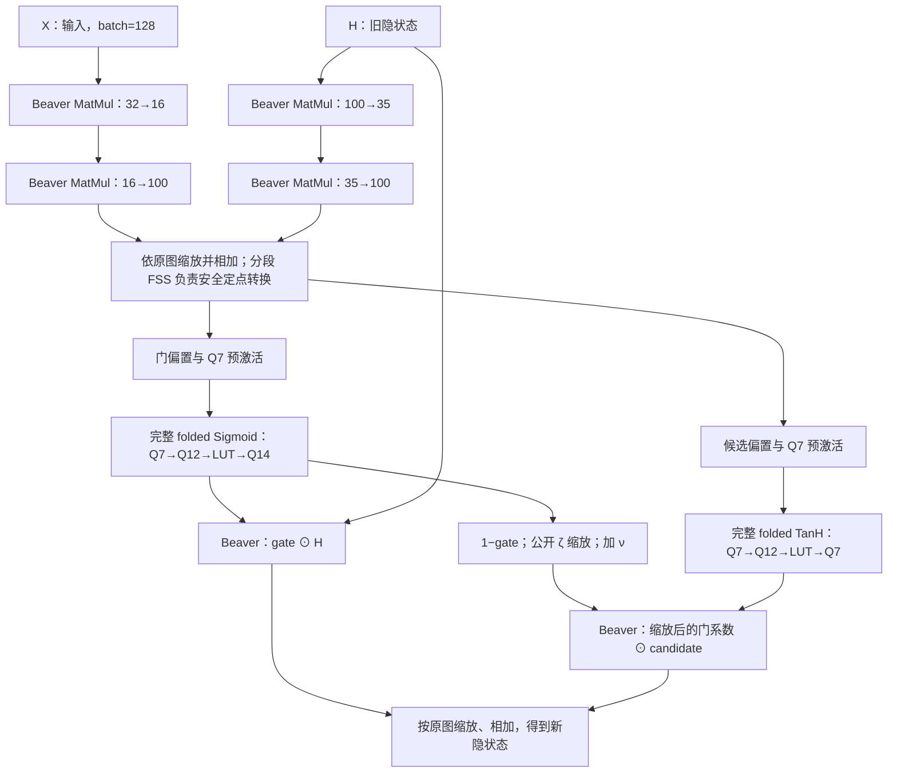

# 论文 Sigmoid/TanH 完整 LUT 替换 SCI 激活与并行优化

**Status:** ready-for-agent

**Labels:** ready-for-agent

**日期:** 2026-10-13

**发布方式:** 项目既有本地 Markdown 工单；本规格供后续拆票和实施。

**范围来源:** 用户要求按 `paper/main.pdf` 的 folded Sigmoid/TanH，实现 Beaver＋分段 FSS＋DPF-LUT 完整激活组合，并替换当前仍执行 SCI 指数、倒数与合成计算的激活路径。

**主测试接口:** 继承用户此前已认可的两方 FastGRNN/Google-30 完整单时间步，batch=128，默认与非零隐状态；复用现有 CLI、诊断张量和阶段计量。原有激活两进程测试补足整数边界，明文完整序列评估补足新近似的模型质量证据。

**完成含义:** `ready-for-agent` 表示方案可实施；不表示代码、正确性、模型质量或性能已经验收。

## Problem Statement

当前具名后端 `SCI_Beaver_segmented_DPF_LUT` 替换的是 SCI Sigmoid/TanH 内部的指数小表和倒数系数小表。查表之后仍执行 SCI 的分位合成、乘法、截断、倒数近似及结果恢复。这个后端保留 SCI 的整数映射，其历史结果不能代表论文中的完整 folded LUT 激活。

论文采用另一条数值路径：提取符号、取幅值、裁剪、生成十位索引，查询 1024 项公开 correction 表，再恢复符号；TanH 复用同一 Sigmoid 核。这条路径不需要 SCI 的在线指数与倒数计算，但仍需要论文明确列出的安全比较、BitXA 和截断。公开表与选择份额相乘是本地运算，最终符号恢复中的秘密 bit×秘密值仍是安全乘法。

仓库已经有完整 folded 激活批量核和历史 Google-30 接入原型，但还不能直接作为当前并行组合交付：原生 Q7 接口与论文 Q12 内核需要安全适配；多个原语依赖全局通信上下文；旧分段 LUT 预计算全部循环移位输出，存在 O(ND²) 工作；新算术 DPF 路径又采用完整 q 位树，需要与论文分段构造区分。

用户需要一份能够直接指导实施的方案，明确从 Beaver 线性层到新非线性层的调用链、已经具备的并行能力、本次需要补齐的优化，以及如何验证完整替换和实际收益。

## Solution

交付独立具名组合 `SCI_Beaver_segmented_PaperLUT`，显示为“Beaver＋分段 FSS＋论文 folded DPF-LUT 激活”。在完整 Sigmoid/TanH 算子入口分派到论文协议，复用现有 Beaver 线性与尾部乘法、分段 FSS 定点转换及图调度。

新激活固定内部 32-bit/Q12、十位索引和 1024 项公开表。LUT 必须交付并比较两种构造：论文的两个五位短段 DPF、平衡张量 AND 与 B2A，以及不分段的完整十位算术 DPF。两者都在输入前生成并驻留相同布局的算术 one-hot，在线使用同一个批量掩码开值和本地内积核。十位索引并不要求分段；保留分段版作为论文对应参考，通过实测选择推荐构造。保留论文 BitDec 版本作为完整替换基准，在同一整数语义下单独评估分段 FSS 符号测试候选。

### 从线性到非线性的整步数据流

两条矩阵链、两种激活、两条尾部更新链分别在其依赖满足后并行。图中的箭头包含原整数程序要求的截断和扩环；浮点代数恒等式不授权重排这些定点运算。

### 冻结的数值映射

设输入编码为有符号 16 位整数 x₇，其实数解释为 x₇/128。先安全有符号扩环到 32 位，再本地乘 32，得到 Q12 编码 x₁₂。公开表为：

\[
T_\delta[j]=\left\lfloor\frac{4096}{1+\exp(j/64)}\right\rfloor,
\qquad 0\leq j<1024.
\]

Sigmoid 核对 Q12 编码 x 执行：

\[
\begin{aligned}
d&=\mathbf1\{x\geq0\},\quad p=\operatorname{BitXA}(d,x),\quad a=2p-x,\\
i&=\mathbf1\{a<65536\},\quad c=65535+\operatorname{BitXA}(i,a-65535),\\
t&=\lfloor c/64\rfloor,\quad \widehat\delta=T_\delta[t],\\
S_{12}(x)&=\widehat\delta+\operatorname{BitXA}(d,4096-2\widehat\delta).
\end{aligned}
\]

完整原生接口的输出冻结为：

\[
\operatorname{Sigmoid}_{Q14}(x_7)=4S_{12}(32x_7),
\qquad
\operatorname{TanH}_{Q7}(x_7)=\left\lfloor\frac{2S_{12}(64x_7)-4096}{32}\right\rfloor.
\]

TanH 的最后一次除以 32 向负无穷取整。该映射沿用仓库历史 folded 激活 oracle，区别于原图其他位置可能采用的向零除法。每个核心激活包含两次符号测试、三次 BitXA、一次精确索引截断和一次 LUT；接口扩环及 TanH 输出缩放另计。

## User Stories

1. 作为论文作者，我希望实现与论文 folded Sigmoid/TanH 公式对应，从而能准确说明方法实际执行的协议。
2. 作为推理使用者，我希望完整激活直接调用新 LUT 路径，从而消除旧 SCI 指数与倒数合成链。
3. 作为复现者，我希望旧 SCI、SCI 小表 DPF 与完整论文激活各有明确名称，从而正确解读历史和新增结果。
4. 作为开发者，我希望复用已有完整激活批量核，从而集中处理接入、上下文和性能问题。
5. 作为模型使用者，我希望原生 Q7 输入和两种输出尺度明确，从而使新激活正确连接既有线性层与状态更新。
6. 作为数值验证者，我希望先安全扩环再放大输入，从而覆盖全部 16 位编码及最小负数。
7. 作为数值验证者，我希望 TanH 在宽环内倍增，从而避免溢出改变符号或 LUT 索引。
8. 作为数值验证者，我希望负数输出的缩放规则冻结，从而避免向零与向负无穷取整混用。
9. 作为协议维护者，我希望表项、索引范围和裁剪顺序固定，从而获得可独立验证的整数函数。
10. 作为协议维护者，我希望两种激活共用公开 correction 表，从而减少重复常量准备。
11. 作为安全审查者，我希望每个秘密索引使用独立新鲜掩码，从而保证不同元素与请求之间的隐私。
12. 作为协议维护者，我希望短段 DPF 安全组合成完整 one-hot，从而落实论文分段 LUT 构造。
13. 作为计算优化者，我希望驻留选择份额并在线求一次内积，从而去掉全部循环移位输出的二次复杂度预计算。
14. 作为计算优化者，我希望公开表乘法在本地完成，从而避免额外消耗 Beaver 材料。
15. 作为运行时维护者，我希望完整激活显式持有通信和 OT 上下文，从而安全支持多个 worker。
16. 作为运行时维护者，我希望材料、游标和工作区按 worker 隔离，从而避免并行请求串用状态。
17. 作为性能优化者，我希望同一协议阶段跨元素合批，从而减少逐元素通信与调度开销。
18. 作为性能优化者，我希望 Sigmoid 与 TanH 两条分支并行，从而缩短图的关键路径。
19. 作为性能优化者，我希望每种激活的本地查表按元素分片，从而利用已有四核资源。
20. 作为性能优化者，我希望保留输入与状态矩阵链并行，从而使激活替换接入已有整步优化。
21. 作为性能优化者，我希望保留两条尾部更新链并行，从而减少激活之后的等待。
22. 作为性能优化者，我希望评估分段 FSS 符号测试，从而量化降低 BitDec 进位深度的收益与离线代价。
23. 作为资源审查者，我希望所有层共享四个逻辑 CPU 和 1.5 GiB 预算，从而获得资源匹配的对比。
24. 作为推理使用者，我希望查询输入到来前材料已经实际生成并驻留，从而获得可解释的在线成本。
25. 作为运行时维护者，我希望预处理只生成实际采用的协议材料，从而避免新旧激活库存重复计费。
26. 作为正确性验证者，我希望两种激活对全部 65536 个输入编码符合新整数 oracle，从而确认完整映射正确。
27. 作为正确性验证者，我希望串行、分片和图并行输出一致，从而确认调度不改变数值语义。
28. 作为模型使用者，我希望默认与非零隐状态都通过完整单步验证，从而覆盖真实递归更新。
29. 作为质量审查者，我希望完整明文整数网络重测冻结验证集，从而检查激活近似变化对模型质量的影响。
30. 作为质量审查者，我希望新的质量结果与历史 SCI 整数图结果区分，从而知道结论对应哪个数值程序。
31. 作为实验分析者，我希望分别报告完整激活、LUT 子步骤与整步成本，从而定位优化收益来源。
32. 作为实验分析者，我希望分别看到 setup、模型准备、离线、在线和首请求成本，从而评估部署代价。
33. 作为实验分析者，我希望使用真实通信轨迹计算关键路径轮次，从而正确评价并行协议。
34. 作为实验分析者，我希望相同数值函数的串并行消融独立于 SCI 方法比较，从而区分数值替换与调度收益。
35. 作为复现者，我希望保留新鲜请求、资源峰值、失败状态和完整配置，从而重现报告中的结论。
36. 作为项目维护者，我希望完整替换的功能验收与默认优化资格分别记录，从而如实处理正确但存在阶段代价的方案。
37. 作为项目维护者，我希望沿用既有完整单步与激活测试入口，从而减少重复测试设施。
38. 作为项目维护者，我希望得到明确的实施依赖和完成条件，从而能够据此拆分工单并执行。
39. 作为性能优化者，我希望完整十位不分段 DPF 成为必测候选，从而判断 1024 项小表是否需要分段。
40. 作为实验分析者，我希望两种 LUT 构造共享在线表示、计算核和调度，从而检查实际在线效率并准确解释差异。

## Implementation Decisions

### A. 完整替换边界与后端身份

- 新组合后端固定命名为 `SCI_Beaver_segmented_PaperLUT`，激活数值算法标记为 `folded_sigma_f12_q10`。名称中的 segmented 指外层分段 FSS，LUT 是否分段另由 `lut_key_family` 和 `lut_segments` 显式记录。入口包含算子种类、元素数、输入与输出环宽/小数位、上下文身份，以及对应材料计划。当前支持的原生契约是输入 16-bit/Q7、Sigmoid 输出 16-bit/Q14、TanH 输出 16-bit/Q7。
- 替换发生在完整 Sigmoid/TanH 分派处。选中新后端后，原 SCI 激活函数体以及其指数 digit LUT、倒数系数 LUT、相关除法与结果合成均不执行；其余图算子仍使用已定义的 Beaver、分段 FSS 和必要原生运行时能力。新路径不静默回落到 SCI 激活。
- 旧 `SCI_Beaver_segmented_DPF_LUT` 继续唯一表示“SCI 整数算法＋内部小表 DPF”。新后端不复用它的结果标签或默认资格。显式 SCI 对照由原 SCI 实现提供。
- 构建继续使用项目私有 SCI overlay。扩展现有 planner、worker dispatcher、材料库存和计量接口；旧 q≤8 的 SCI 小表 bridge 不能承担新 q=10 完整算子的契约。
- 以现有完整 folded 核和历史整激活接入为原型，修复宽环、数值适配和上下文后接入当前运行时。原型存在不等于新的组合已实现或通过验收。

### B. 数值与转换契约

- 核心输入、BitXA 和 LUT 算术输出均使用 32 位环，f=12、q=10。原生有符号输入先经现有安全分段 FSS 扩环，再本地乘 32。两方分别对本地份额做符号扩展不满足这个契约。
- 全域输入放大后的有符号范围为 [−1048576,1048544]；TanH 倍增后为 [−2097152,2097088]。这些范围以及后续取幅值、减 65536 在 32 位环内均有足够余量。不能先在 16 位环内放大、倍增或取绝对值。
- 公共表的 1024 个整数项在查询前固定，使用高精度参考逐项核对后按表版本复用。运行时不根据秘密输入生成表，不在线计算 exp；公开常量按既有一方加常量约定注入算术分享。
- 严格执行“符号→幅值→裁剪→六位精确截断→十位索引→LUT→符号恢复”。非负 c 的索引环宽按 32→26→10 处理：安全截断后，本地取模到十位索引环。d 包含零点；零点输出为 Sigmoid Q12 的 2048、原生 Sigmoid Q14 的 8192、TanH 的 0。
- Sigmoid Q12 输出本地乘 4，再将份额缩环到 16 位；输出范围为 [0,16384]。TanH 先在 32 位环得到 [−4096,4096] 的 Q12 值，再安全执行精确 truncate-reduce，得到向负无穷取整的 Q7 值，环宽按 32→27→16 处理：先安全截去五位，再本地缩环到 16 位；输出范围为 [−128,128]。秘密算术份额不能逐方右移来代替安全截断。
- 原图中激活以外的每个乘法、缩放、偏置和截断沿用该算子原有整数规则。新数值程序由“冻结原整数图＋这两处完整激活替换”定义；激活后的张量允许与原 SCI 图不同。

### C. 分段与不分段 DPF-LUT

- 论文参考构造记为 `lut_key_family=segmented_boolean_tensor_b2a`，使用两个五位段，配置为 `lut_segments=2`、段宽 (5,5)。通用合并器采用按层批量的平衡张量树；本配置只有一层段间 AND。q=10 LUT 的分段配置与外层比较器的 `fixed-4` 分别记录。
- 不分段构造记为 `lut_key_family=full_q_arithmetic`，配置为 `lut_segments=1`、段宽 (10)。复用已有 dealerless 完整 q 位树算术 DPF，完成单位 payload 适配、全域求值并直接生成 32 位算术 one-hot；无需跨段张量 AND 或逐叶输出 B2A，mask-bit 的 B2A 及实际 payload 生成成本仍计入离线。这是必交付候选，不再是可选辅助对照。
- 两种构造每个查表元素均离线生成十个均匀 Boolean mask-bit 份额，批量 B2A 到索引环并组合为 r。分段构造的短段 DPF 秘密目标来自同一组 bit，段内局部求值得到 Boolean equality 向量；通过安全 AND 张量积得到完整 Boolean one-hot，再批量 B2A 到 32 位算术环。两个本地段份额的普通本地乘法不能替代这个安全组合。
- 两种构造离线结束都保留 r 的算术份额和 1024 项算术选择份额 v，使双方重构满足 v[u]=1{u=r}；不保留所有循环移位后的输出份额表。使用相同的连续 32 位 packed selection 容器、表布局与在线内积实现，各自的 key 和中间工作区在材料形成后释放。
- 新路径固定采用论文的减法开值约定：公开 z=t−r mod 1024，本地输出为对全部 u 累加 v[u]·Tδ[(u+z) mod 1024]。重构结果等于 Tδ[t]。现有加法掩码版本若复用内积核，需要相应调整旋转约定；不得混用加法开值和减法公式。
- 每个 worker 将同一阶段的索引批量开值，轮转通过公共偏移视图或两个连续区间实现，无需逐元素复制整张表。选择份额乘公共表值不使用 Beaver、不通信；累加遵循 32 位环语义并使用定义明确的无符号运算。
- 两种激活可复用同一公开表和布局，每个元素的 mask、DPF 相关材料及选择份额均独立新鲜。Sigmoid/TanH、不同 worker、不同 query 之间不共享一次性掩码。
- 以 N 个元素、D=1024 计，两种构造的最终物化和在线内积都保留 O(ND) 工作。分段减少 keygen 的段深度和局部树展开，但本分段构造每元素仍有 1024 次离线张量 AND 和 1024 个输出 B2A，全部计费；不分段算术构造承担完整树生成和算术 payload 适配成本。两种构造的最终 selector 均为 100 MiB/方/单步，离线临时工作区可能不同。
- 相同驻留表示与在线核下，两种构造均为一次批量索引开值加 1024 项本地内积，在线通信量、因果轮次和渐近计算量相同。不分段减少的是特定离线步骤，不能直接推导在线更快；必须实测开值、内积、完整激活和整步耗时。在线阶段都不重新执行 DPF 全域求值或段间合并。
- 这组对照同时改变分段方式和算术 payload/B2A 构造，报告称为“LUT 构造比较”，不把离线差异全部归因于是否分段。推荐构造由阶段实测及资源资格决定，不预先指定分段胜出；旧 O(ND²) 全移位输出预计算不进入默认。

### D. 符号测试与完整激活批量核

- 必交付基准采用论文当前实现的 BitDec 符号测试。两次测试、三次 BitXA、精确索引截断和 LUT 均在同一阶段跨元素合批；这复用了现有批量核的组织方式，新增工作集中于可并行上下文、预处理和 LUT 物化。
- BitDec 进位依赖按位推进，32 位版本每次测试有 31 个进位层；批量化不会自动去掉这些依赖。所有符号测试所需 Boolean triples 在输入前生成，在线只消耗，阶段账目反映这一安排。
- 增加独立候选 `sign_backend=segmented_fss`：复用私有 DReLU/MSB 获得 d 和 i，仍执行相同幅值、裁剪、索引和符号恢复。它采用外层已验证的分段比较协议与公开分段配置，逐位输出必须与 BitDec 基准相同。
- 分段符号候选先单独通过全输入与阶段成本验收，再决定是否进入推荐并行配置。协议名称和轮次据实记录；BitDec 版本不标成“激活内部也已使用分段比较”，候选结果也不套用论文 BitDec 成本式。
- 一次 LUT 开值是一轮子协议。完整激活仍有符号、幅值、裁剪、索引、查表、恢复的依赖链，且包括接口转换，不宣称完整 Sigmoid/TanH 一轮完成。

### E. 上下文隔离与并行执行

- 为完整激活调用链贯通显式执行上下文：角色、Peer/IO、OT、随机源、材料库存、游标、计量 actor 与工作区均由调用所属上下文持有。改造范围覆盖激活、BitXA、精确截断、B2A/Boolean AND、DPF 预处理和所有开值辅助路径；不能只删除顶层的全局 peer 检查。
- 独立 worker 不通过临时切换进程全局 peer 或加一把覆盖整个激活的大锁实现并行。共享全局默认上下文仅兼容旧串行入口；新具名后端全程传递自己的上下文。
- 保留已有两条线性链并行、gate/candidate 分支并行及尾部两链并行。推荐候选为每种激活两个常驻 worker，各处理 6400 个元素；两种激活合计四个并行参与者，每个 worker 独占通信与材料。
- LUT 内积按元素分给既有 worker，单个 worker 内采用连续布局与编译器可向量化循环，不另起嵌套线程池。保留单 worker 和图串行配置，用于正确性对照和并行收益测量。
- 两种构造的离线 keygen 均按相同公开深度与形状合批；分段版张量 AND 按合并树层合批，不分段版批量完成算术 payload 适配；B2A、BitXA 和截断材料构造尽可能使用已有批量 OT 接口。tile 只限制生成峰值和工作区，不将在线元素逐个交互。
- 复用现有 cGGM 常驻计算池、AES 批处理和连续工作区。网络收发由所属上下文的调用线程执行，计算任务按公开范围分片；受限池当前会串行化部分生成批次，首版以批处理和受控本地并行为准，不声称四个离线 slot 已完全并发。
- 全阶段每方最多四个同时计算参与者。并行双分支各最多两个；多 activation worker 场景每 worker 一个 OT 参与者，单 worker 可按已有预算使用两个。Eigen 内部并行继续关闭，cGGM 参与者也纳入同一额度。
- 当前已有 `fixed-4`、连续 keys、`fuse-domains`、`pair-extensions`、`pack-bits`、`aes-online`、`beaver-algebra`、Beaver tile rows=32、模型偏置预计算、尾部并行，以及 `direct_ot`、叶 CW 合批、生成工作区复用、equality/叶哈希裁剪、`pack-ring` 等具名组合能力。新运行配置显式记录适用开关；历史组合资格不能推导各开关独立收益。
- 离线 Beaver/FSS overlap、跨分支开值融合、mapped Eigen layout、offline AES 等历史实验不自动进入新默认。它们也不作为本次完成完整激活并行接入的必要条件。

### F. 材料生命周期与内存

- planner 从公开形状和显式 LUT 构造一次规划完整激活及适配材料，包括输入扩环、两次符号测试、三次 BitXA、索引截断、选定构造的 LUT，以及 TanH 输出截断。每次运行只生成所选构造的材料。新后端删除已被替换的 SCI 激活 exp/reciprocal 与相关运算库存需求；图内其他调用按真实需要保留。
- 每查询的所有随机材料都必须在输入及旧隐状态装载前实际生成并驻留。主阶段沿用 setup、模型准备、query prepare、input/ready、online、output/结束；生成、求值、B2A、装载的实际发生时间决定计费阶段。
- 所有材料绑定 query、层/算子、worker、slot、元素范围、环宽、小数位、表版本和协议族；同一材料一次消费。复用公开表及模型常量不等于复用一次性密钥。库存不足或形状错配明确失败，不在线补料或静默调用旧 SCI。
- 每方总地址空间硬限为 1.5 GiB，既有 FSS prefetch 上限为 512 MiB，且计入同一总额。单步两种激活共 25600 个元素，32 位 packed selector 本身为 25600×1024×4 bytes，即 100 MiB/方；这不是总峰值估计。
- 联合预算还要包含外层 FSS、Beaver、符号 triples、所选 LUT 构造的物化工作区、OT、常驻线程栈和输入输出缓冲。按公开 tile 生成并释放中间量；所有最终选择向量仍须在输入前就绪，不能靠在线加载降低报告峰值。
- 一个 query 完成或中断后释放其剩余材料。连续两个 query 各自生成新材料并核对实际消费，不将随机预处理按多次查询摊薄。

### G. 对照、计量与推荐配置准入

- 必测对照为：原生预处理 SCI；Beaver＋分段 FSS＋原生 SCI 激活；现有 SCI 内部小表 DPF；新完整 folded LUT 的分段和不分段两种构造。两种构造各跑图串行/单 worker 与图并行/双 worker，形成四个必测匹配行。分段符号候选另与 BitDec 版本作匹配对照。
- LUT 构造对照固定同一 BitDec 符号后端、输入、表版本、32 位 packed 布局、在线内积实现、索引编码、编译选项、CPU/内存和各调度参数。并行比较使用相同 worker 切分。各次请求使用独立新鲜材料，正式行交错安排两种构造、每行仍串行执行，以降低机器状态随时间漂移的影响。
- 构造对照必须单列离线 keygen、全域物化、AND/B2A 或 payload 适配、材料峰值，以及在线开值、内积、完整 Sigmoid/TanH 与整步墙钟。报告分段时间/不分段时间的比值及置信区间，区间整体大于 1 才称不分段更快，跨 1 记为未分辨。相同在线核下若出现可复现差异，检查缓存、缓冲布局和调度来源；仅离线改善不写作在线加速。
- 图并行、模型常量准备和适用的资源策略同时提供给对照。新旧数值算法之间的结果称为方法比较；同一 folded 整数函数的调度/协议变化才用于归因并行优化。保留“图并行＋每激活单 worker”一行以区分双分支与元素分片收益，不做所有开关全排列。
- 分别报告 setup、公共表/模型准备、每查询离线、在线、直接查询总成本和首请求成本；同时报告完整 Sigmoid、完整 TanH、接口转换、符号/裁剪、BitXA、索引截断、LUT 的子阶段。并行子阶段耗时不能简单相加代替关键路径墙钟。
- 通信记录真实双端字节和因果轮次，覆盖新上下文、OT 与开值通道；从 fork/join 依赖计算关键路径，不能将所有 worker 轮次相加。LAN/WAN 模型使用项目既有冻结参数，实测与模型估算分列。
- 正式每行十个 fresh query、warmup=0，沿用每行 600 秒预算，各行串行执行且避开构建重负载。保留 OOM、timeout 和未完成状态；无法完成的行不以小 batch 替代。
- 完整替换的功能完成条件是整数正确、原生激活路径实际退出、输入前材料资格与四核/内存约束通过。另以模型质量门槛判断该数值程序是否适合当前模型，以实测判断优化候选是否适合推荐；三项判定分别记录。
- 同一数值程序的优化推荐继承两阶段准入：相对具名父配置，离线与在线通信模型和墙钟均无可复现退化，且至少一项有可复现改善。使用现有固定的置信区间方法，区间跨 1 记为未分辨；阶段交换候选保留实验身份。与旧 SCI 的方法比较如实报告全部代价，不假定查表必然更快。

### H. 实施依赖与交付顺序

| 顺序 | 交付 | 前置与退出条件 |
| --- | --- | --- |
| 1 | 冻结表、Q7/Q12 适配和新的整图整数参考 | 原生全输入 oracle 与表项已定义；记录数值与模型契约。 |
| 2 | 显式上下文贯通与输入前材料计划 | 现有原语测试通过；新旧上下文兼容，材料可按 worker 隔离。 |
| 3 | 分段与不分段 one-hot 物化及完整激活串行接入 | 两种 q=10 构造正确；各自两种激活覆盖全部原生输入编码；新后端不进入旧 SCI 激活。 |
| 4 | 两种 LUT 构造的图并行、双 worker、批量生成与共享内积核 | 两种构造的串并行一致；连续 query 生命周期及真实四核/内存约束通过。 |
| 5 | 分段符号候选与匹配归因 | 与 BitDec 逐整数一致；阶段差异和推荐资格独立记录。 |
| 6 | 完整单步、新近似质量及公平性能报告 | 包含分段/不分段的四行必测对照，明确回答在线效率是否可分辨；交付配置、命令、逐查询结果与各阶段判定。 |

## Testing Decisions

1. **主接口继承已有用户确认。** 以现有两方 FastGRNN/Google-30 单步 CLI 和诊断输出作为唯一新增集成验收主线。覆盖 batch=128、默认及非零隐状态；保留既有图语义对应的 15 个张量、172928 个整数和最终状态诊断。性能运行关闭中间明文揭示。batch=1 只承担快速边界与接入验证。
2. **新的独立整数参考。** 复用历史 folded oracle 的语义，扩展现有整图明文回放以调用上述两个新激活。参考程序用明文整数、公开表和明确 floor 运算，不调用安全实现生成 expected。第一次激活之前的同输入张量仍可与 SCI 逐位核对；激活及后续张量与新 oracle 核对。原 SCI 只报告差异数量、最大差异等，不能把差异直接判成错误。
3. **全输入激活测试。** 扩展已有真实两进程完整激活 harness，分段与不分段构造各自对 Sigmoid/TanH 覆盖全部 65536 个原生 16 位编码，与新 oracle 零差异；按资源预算分批，使用不同随机分享。单独覆盖最小负数、零、正负一个输入 ULP、±8/±16 邻域、索引进位和负 TanH 缩放。无法由 Q7 表达的 Q12 边界通过已有内核测试覆盖。
4. **公开表与协议边界。** 逐项验证 1024 个整数表值；复用已有 DPF/LUT 两方测试验证同一 mask 的 Boolean/算术表示、分段版的 equality/平衡 AND/B2A、不分段版的完整树算术 payload 与全域 one-hot，以及两者的全部索引和模回绕。验证共同的减法开值与旋转约定一致，以及输出重构等于表值。公开 fixture 可用于检查中间量，正式性能不揭示秘密 mask 或选择向量。
5. **安全定点适配。** 验证输入 signed 扩环、六位索引截断、TanH 五位 floor 缩放和缩环。特别覆盖−32768、接近零的负数、输出−128/128、Sigmoid 的0/8192/16384；不能仅靠饱和输入通过证明整个接口正确。
6. **完整替换覆盖。** 用现有可观察协议计量确认新完整激活实际消费自己的材料，旧 exp/reciprocal 激活库存需求与消费均为零；核对调用轨迹未进入旧激活函数体。其他图算子的 SCI 调用不应被误判为替换失败。
7. **并行与上下文。** 同一公开输入分别运行图串行、双分支单 worker、双分支双 worker，并测试非整分片尾部，重构输出与同一 oracle 一致。串并行运行各用新材料。复用上下文库存与轮次测试检查通道归属、fork/join 和连续两个 query；不将随机分享本身不同视为数值差异。
8. **材料资格与资源。** 所有最终材料须在 input/ready 前实际生成并驻留；输入后 keygen、OT/三元组补充、材料加载和等待增量为零。核对库存不足、重复消费、参数错配的既有失败行为。实测每方 RLIMIT_AS、峰值 RSS/AS 及同时计算参与者；100 MiB selector 公式不能替代联合峰值验收。
9. **分段符号候选。** 对同一全输入集和完整单步，候选与 BitDec 输出逐整数一致；分别计量两个符号测试和整体激活。只对这项真实协议变更补充现有比较原语回归，不为已有无变化功能重复建立测试。
10. **模型质量门槛。** 使用同一冻结 checkpoint、量化图、归一化和官方 valid 6798 条，运行新明文整数网络的完整 99 步与分类头。相对同 checkpoint FP32 的 Top-1 损失不超过既有 1.0 个百分点；记录逐样本预测、Top-1、与旧 SCI 整数网络的预测一致率。valid 后不得调参，失败如实记录。这是新的数值算法质量评估，不能称为完整数据集安全执行准确率。
11. **新性能证据。** 在相同单步、数据、资源、网络模型与共同优化条件下执行规定的匹配行。保存逐请求阶段数据和有效失败，不复用历史小表 DPF 性能、旧 folded 单独测试或旧 SCI 整数图质量作为新组合通过证据。至少给出两种完整激活、整步和串并行归因三种视角。
12. **测试原则与先例。** 测试重构整数、可观察协议路径、材料生命周期、资源和阶段成本；避免镜像内部函数实现。直接复用 prepared activations、native DPF、DPF round trace、完整转换以及整步非零隐状态测试设施。最高层覆盖不了的密码学和定点边界才下沉到现有原语接口，不另建平行应用 runner。
13. **不分段必测与在线效率结论。** 在相同数值、资源与在线实现下，完成“(5,5) 分段/完整 10-bit 不分段”各自的串行和并行正式行，每行十个 fresh query。两种构造均通过默认及非零隐状态整步诊断和输入前驻留资格。比较 LUT 开值、内积、完整激活、整步在线耗时及通信/轮次，并同时报告离线和峰值内存；不得以两者理论复杂度相同为由省略实测。最终明确给出“不分段在线更快、分段在线更快或未分辨”的判定与置信区间。构造选择改变不了已冻结的数值映射，无需因此重复运行同一明文模型质量评估。

## Out of Scope

- 本次交付是规格及本地工单发布，不执行代码替换、拆票、基准重测或论文正文修改。
- 99 步安全整网、分类头安全执行、ArgMax 与全验证集两方推理仍属后续工作；本方案仅要求新数值算法的明文全序列质量检查，安全性能验收为 batch=128 单时间步。
- 不训练或重选 checkpoint，不重新搜索量化、改变 q/f 或在 valid 结果后修改近似。需要新数值方案时单独提出并保留失败结果。
- 不要求新激活与 SCI 的近似逐位相同；不保留 SCI 指数/倒数链作为新后端的静默回退。
- 不展开完整 16 位或 32 位输入域 LUT，不默认预计算全部移位输出，不通过在线加载或在线重新生成规避输入前驻留约束。
- 不新增可信 dealer、恶意安全、跨查询随机材料复用、额外 CPU/内存额度或跨 query 流水服务。
- 不把论文 BitDec 版本、分段符号候选或完整 q 位算术 DPF 混记为同一协议成本；不从单步或 LUT 子步骤外推完整安全网络加速。

## Further Notes

### 本次需求对旧规格的覆盖

旧规格冻结 SCI 整数激活，明确只替换指数和倒数小表。本次用户要求按论文完整替换，因而明确覆盖旧规格“不得改变激活近似、不得接入 f12/q10 SIGMA”的范围限制。模型、外层图和历史结果身份按各自契约继续区分。

用户随后要求检查 1024 项表是否有必要分段，本规格已将完整十位不分段算术 DPF 从可选辅助对照提升为必交付、必测候选。两种构造的选择向量均在离线形成，故在线算法相同；方案明确要求实测在线效率，同时报告离线代价。推荐配置不预先固定为分段。

论文主 PDF 的第 11 页、式 (21)–(26) 给出 folded 激活；第 10 页 Algorithm 5 给出分段 LUT。论文同时说明该构造与 SiRNN 数值程序不同。当前源码已经为批量符号测试提前生成 triples，而论文相应文字还描述在线生成；新报告应按实际阶段记账，论文同步修订单独处理。

### 估算边界

- q=10、25600 次查表的双端掩码索引理论位计数为 2×25600×10/8=64000 bytes，对应紧密十位打包。复用当前每索引 ceil(q/8)=2 bytes 的字节编码时，双端索引载荷为 102400 bytes；未实现的紧密位打包不能计作收益。两者均未含 framing、符号测试、BitXA、截断、输入扩环及整步其他协议，实际通信以计量为准。
- 单步 packed selector 约 100 MiB/方。若按相同方式为 99 步全部驻留，仅该项约 9.67 GiB/方，已经超过当前 1.5 GiB 限额；本方案不由单步可运行推导安全整网可驻留。
- 论文中原生 f12/q10 扫描误差约为 Sigmoid 0.0038451390、TanH 0.0075682149。这些属于相应扫描范围的实数函数误差，不能直接当作 Q7/Q14 适配后误差或模型准确率保证。

### 代码与证据入口

| 用途 | 入口 |
| --- | --- |
| 论文当前 PDF 与方法源文 | [main.pdf](../../paper/main.pdf)、[main.tex](../../paper/main.tex) |
| 现有完整 folded 离线、表与旧移位输出物化 | [activation.cpp](../../project/our/src/activation.cpp) |
| BitDec、BitXA、截断、LUT 的完整批量激活链 | [activation_batch.cpp](../../project/our/src/activation_batch.cpp) |
| packed one-hot、完整 q 位算术 DPF 与本地内积 | [dpf_lut.cpp](../../project/our/src/dpf_lut.cpp) |
| 历史完整激活 bridge 与待修复的上下文/位宽边界 | [sci_msb_bridge.cpp](../../project/our/src/sci_msb_bridge.cpp) |
| BitXA 与精确 truncate-reduce 的上下文改造 | [relu.cpp](../../project/our/src/relu.cpp)、[exact_truncation.cpp](../../project/our/src/exact_truncation.cpp) |
| 已有 Q7→Q12→Q14/Q7 数值 oracle | [verify_activation_outputs.py](../../project/our/tools/google30_hybrid/verify_activation_outputs.py) |
| 历史完整激活接入与单步诊断先例 | [hybrid build.py](../../project/our/tools/google30_hybrid/build.py)、[run_step.py](../../project/our/tools/google30_hybrid/run_step.py) |
| 当前单步主 runner、私有 overlay 与四上下文 worker | [runtime run.py](../../project/our/tools/segmented_dcf_runtime/run.py)、[build.py](../../project/our/tools/segmented_dcf_runtime/build.py)、[native_workers.cpp](../../project/our/tools/segmented_dcf_runtime/native_workers.cpp) |
| 旧 SCI 内部小表替换与 DPF bridge | [native_dpf_lut.cpp](../../project/our/tools/segmented_dcf_runtime/native_dpf_lut.cpp)、[sci_dpf_bridge.cpp](../../project/our/src/sci_dpf_bridge.cpp) |
| Beaver 与外层转换接入 | [adapter.cpp](../../project/our/tools/sci_beaver/adapter.cpp)、[hook.cpp](../../project/our/tools/sci_conversion/hook.cpp) |
| 既有用户认可的主测试接口与旧数值范围 | [联合优化规格](../sci-ours-joint-optimization-dpf-activation/spec.md) |
| 既有组合配置、资源与性能证据 | [联合优化报告](../../project/our/results/sci_ours_joint_dpf_20261013/REPORT.zh.md)、[配置资格](../../project/our/results/sci_ours_joint_dpf_20261013/default-configurations.json) |
| 冻结验证集与 1.0 个百分点门槛 | [freeze_policy.json](../../project/our/results/ticket02_independent_quality/freeze_policy.json) |
| 历史全量结果，仅作旧 SCI 整数程序证据 | [full_quality.json](../../project/our/results/ticket07_hybrid_full/full_quality.json) |
| 本地 Markdown 工单与标签先例 | [预处理基线索引](../sci-sirnn-preprocessed-baseline/README.md) |

规格按本次显式调用的 [to-spec skill](/home/jiang/.codex/skills/to-spec/SKILL.md) 发布。主测试接口继承既有用户确认，不新增应用级测试入口；此工单仅覆盖本次完整论文激活替换及其必要验证。
