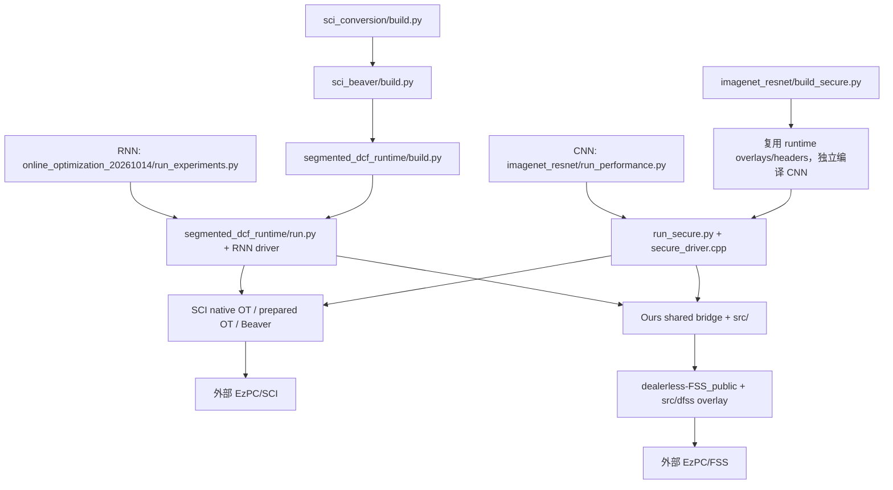

本清单按 2026-10-19 的工作树整理，覆盖 SCI+Ours、SCI/SiRNN 预处理、ImageNet CNN 和 Google-30 RNN 代码。仓库根目录为 `/home/jiang/dealerless-lunwen`；下文未以 `/` 开头的路径均相对此根目录。`source_inventory.tsv`、`github_sources.list` 和 `inventory_summary.json` 是上传前的范围快照；源码包以白名单列出的工作树文件为准。未完成实验和服务器迁移事项见 [OPEN_TASKS.zh.md](OPEN_TASKS.zh.md)。

当前最值得先处理的问题是 `.git/info/exclude` 包含 `*` 和 `!.gitignore`，隐藏了全部未跟踪文件；仓库根目录目前也没有共享 `.gitignore`。最近的 `tools/imagenet_resnet/` 和 `tools/precision/` 中有关键代码尚未跟踪；普通 `git status`、`git clone` 和 `git archive HEAD` 都不能完整覆盖当前实验。不要使用整库强制添加：模型、数据、虚拟环境和轨迹会一起进入 Git。

本目录附带的清单可以直接用于逐文件核对：

| 文件 | 内容 |
| --- | --- |
| [source_inventory.tsv](source_inventory.tsv) | 当前项目源码、测试、构建模板、相关实验脚本；含组件、字节数、Git 状态和可选归档标记 |
| [github_sources.list](github_sources.list) | 建议保留进源码包的仓库内文件白名单，不含数据、权重和二进制 |
| [git_missing_sources.list](git_missing_sources.list) | 上述白名单中尚未被 Git 跟踪的文件 |
| [required_inputs.tsv](required_inputs.tsv) | 运行输入、数据、权重、断点和证据的目录级清单，注明适用任务 |
| [external_sources.tsv](external_sources.tsv) | 工作区外的本地复现脚本和配置，不能靠推送本仓库自动带走 |
| [external_revisions.json](external_revisions.json) | 外部仓库版本、子模块版本及本地修改路径 |
| [environment.observed.tsv](environment.observed.tsv) | 从当前环境元数据提取的包版本，作为重建依据；不是可直接安装的统一环境 |
| [cleanup_candidates.tsv](cleanup_candidates.tsv) | 精确路径、实测体积、分类和清理条件；不是删除脚本 |
| [inventory_summary.json](inventory_summary.json) | 清单统计、来源 HEAD、生成时间和规则；修改文件数只统计清单范围 |
| [inventory.py](inventory.py) | 重新生成清单；只写本目录，不执行实验、不修改 Git |

当前分支尚未配置 Git remote；本次提交可在本地准备完成，但推送前需要确定目标 GitHub 仓库。

**当前代码框架**



| 路径 | 实际职责 | 建议 |
| --- | --- | --- |
| `project/our/CMakeLists.txt`、`src/` | Ours 协议库和 SCI shared bridge | 整体保留 |
| `project/our/src/{segment,segmented_dcf,cggm,gen}.*` | 分段策略、分段 DCF、相关 GGM 和材料生成 | 保留当前工作树修改 |
| `project/our/src/{sci_truncation,exact_truncation,sci_conversion_bridge}.*` | 截断、定点重缩放和跨位宽转换 | 保留 |
| `project/our/src/{private_msb,sci_msb_bridge,relu}.*` | 比较与 DReLU、ReLU/BitXA 接入 | 保留 |
| `project/our/src/{activation*,dpf_lut*,folded_native*,folded_tanh_native*,sci_folded_bridge*}` | RNN sigmoid/tanh、folded LUT、批处理及近期优化 | 保留；ResNet 不调用 sigmoid/tanh LUT |
| `project/our/src/{linear,model_bias}.*`、`ring_packing.h` | 线性层、偏置与环通信支持 | 保留 |
| `project/our/src/dfss/` | 论文修改过的 dFSS 文件，构建时覆盖到副本 | 保留，不能只带公共参考库 |
| `project/dealerless-FSS_public/` | 参考 dFSS 依赖，当前为同级源码目录 | 保留源码、CMake 和许可证；不带 build |
| `project/our/test/` | 原语正确性、性能、位宽和分段实验 | 保留 |
| `project/our/tools/sci_conversion/` | 完整 RNN 构建入口、值扩展/截断 hooks | 必须保留 |
| `project/our/tools/sci_beaver/` | SCI MatMul/MulCir 的 Beaver 分支、适配器和库存生命周期 | 必须保留 |
| `project/our/tools/segmented_dcf_runtime/` | RNN driver、runner、预处理、独立上下文、计量和审计 | 必须保留 |
| `project/our/tools/sci_bridge/` | bridge 导出符号表和协议回归测试 | `exports.map` 是主 CMake 必需输入 |
| `project/our/tools/runtime_optimization/` | 性能分析与网络通信投影 | 保留 |
| `project/our/tools/google30_hybrid/` | RNN 生成图和 driver 生成器 | 仍被 builder 导入，不能按旧目录名删除 |
| `project/our/tools/google30_mpspdz/` | 整数 oracle、folded/SCI 语义等 | 部分代码仍供 SCI 审计导入；不能整体删除 |
| `project/our/tools/google30_benchmark/link_proxy.py` | 实际限速网络 runner 的依赖 | 保留；最新报告的网络投影不调用限速测量 |
| `project/our/tools/imagenet_resnet/` | 当前 CNN 精度与安全推理工具 | 整体保留源码、测试和 vendor 许可证 |
| `project/our/tools/precision/` | 当前 CNN 的整数 GEMM/CUDA 支持，也包含早期实验 | 保留源码；环境、数据另行处理 |

构建链必须是 `sci_conversion/build.py → sci_beaver/build.py → segmented_dcf_runtime/build.py`。只调用最底层 builder 会遗漏 Beaver/转换 hooks；失败例保存在 `results/online_optimization_20261014/qualification-invalid-build-hooks/`。`google30_*` 等目录的名字不足以判断能否删除，建议先保留所有体积很小的 `tools` 源码。

**最近的 RNN SCI+Ours 测试**

最近完成的主入口是 `project/our/results/online_optimization_20261014/run_experiments.py`，同目录 `audit_integer.py`、`summarize.py`、`README.zh.md`、`CHECKS.zh.md` 解释资格核验和结果。`formal/` 保存四配置、每配置 10 次 fresh query 的报告；`qualification/` 保存零/非零隐藏状态核验。

该工作负载是 **batch=128、单个 recurrent timestep**。Google-30 模型完整输入有 99 个时间步，不能把最近的单步成本写成完整分类成本。四配置为 `ours_online_before`、`ours_online_optimized`、`SCI_SiRNN_preprocessed`、`SCI_SiRNN_unprocessed`。Ours 使用 folded f12/q10 激活，SCI 使用原生激活；跨方法比较包含整数算法差异。LAN/WAN 是通信模型投影，原始本机计时另存。

| 文件/目录 | 作用与保留要求 |
| --- | --- |
| `results/online_optimization_20261014/build/build_runtime.py` | 手写构建入口，虽然放在 build 内仍是源码；写死 `/home/jiang/EzPC/SCI` |
| `results/online_optimization_20261014/build/runtime/sdcf-runtime` | 最新运行二进制；迁移后重建 |
| `results/online_optimization_20261014/build/core/libsegfss_sci_bridge.so` | 与上述 runtime 配套的 bridge，不能混用旧版本 |
| `results/online_optimization_20261014/build/runtime/{runtime_manifest.json,build_commands.json}` | 实际生成源、库和编译命令身份；保留证据 |
| `results/ticket07_hybrid_full/sources/{sirnn_fixed.cpp,model_fixed.h}` | 当前 runtime 使用的冻结 SiRNN 生成图与模型头，必须保留 |
| `results/paper_folded_activation_20261013/ticket11/frozen-plan-final.json` | 最新 runner 直接读取的运行参数来源，必须保留 |
| 同一 ticket 的 `final-build/fixture/` | `client_input.i16`、`server_model.i16`、`contract.json`、README，是当前真实输入 |
| `results/sci_sirnn_resident_20261012/reference/nonzero_hidden.i16` | 当前 runner 默认的非零隐藏状态资格输入 |
| `results/offline_optimization_20261014/` | 上一轮离线优化脚本、消融和报告，保留小文件与关键证据；大轨迹可冷归档 |

本表 `results/` 前缀均为 `project/our/results/`。尤其不要整体排除 `build/`、`final-build/`、`results/`；上面的脚本和 fixture 是实际依赖。

**SCI/SiRNN 的密码预处理**

这一部分是我们为原生 SCI/SiRNN 算子拆分 offline/online 的测试框架，位于 `project/our/tools/segmented_dcf_runtime/`，不等同于音频特征预处理，也不等同于 Ours 的 FSS key 生成。

| 文件 | 职责 |
| --- | --- |
| `driver.cpp.in` | query 生命周期；公开计划、input 前准备、input 后执行 |
| `native_preprocessing.h` | 库存状态、准备/消费计数与生命周期 |
| `native_planning.h`、`native_planning_overlay.py` | 使用公开影子数据取得调用形状，检查规划不通信、不生成随机材料 |
| `native_plan_replay.h`、`native_query_materials.h` | 按计划准备并回放当前 query 的材料 |
| `prepared_got.h` | GOT、batched GOT/LUT 库存和在线修正 |
| `prepared_cot.h` | 算术 COT、B2A 和乘法相关库存 |
| `prepared_triples.h` | Boolean/bit triples |
| `native_{cot,got,triple}_overlay.py` | 给构建目录的 SCI 副本插入预处理路径；不直接修改外部 SCI 原文件 |
| `native_workers.{h,cpp}` | 分支/激活 worker 的独立协议上下文和库存 |
| `PREPARED_COT.md`、`verify_preprocessed_contexts.py`、`test_prepared_*` | 语义说明、库存隔离和生成/消费回归检查 |

流程为：公开图规划 → 输入无关随机 OT/triples 生成 → ready/seal → 加载私有输入 → 在线 correction 和一次性消费。每个 query 生成 fresh 材料；严格路径检查库存形状、耗尽和重复消费，禁止在线临时补货。

`SCI` 后端不启用 `--native-preprocessing`，真实材料生成计入执行时的 online。`SCI_preprocessed` 使用相同 SCI 数值路径，将输入无关随机材料提前准备，在线仍要通信修正，并非把历史计时简单重新归类。当前 RNN 原生预处理支持冻结的单时间步。规格在 `.scratch/sci-sirnn-preprocessed-baseline/`；历史正式结果在 `results/sci_sirnn_preprocessed_20261012/ticket08_fair/`；最新比较在 `online_optimization_20261014/formal/`。

CNN 复用同一组 prepared OT/triples，并通过 `tools/imagenet_resnet/cnn_native_spool.h` 将库存写到临时文件。`build_secure.py` 生成 overlay，已修正消费后仅 clear 而保留 payload 容量的问题。预处理相关源码不能只从外部上游 SiRNN 仓库下载替代。

**CNN 下载、精度与整网性能代码**

| `project/our/tools/imagenet_resnet/` 下文件 | 用途 |
| --- | --- |
| `model.py` | torchvision ResNet-50/152、BN 折叠、精确整数同环算术和导出图 |
| `data_download.py` | 完整 ImageNet 验证集下载与标签校验 |
| `download_calibration.py`、`calibration.py` | 官方训练归档抽取、冻结 2000 张训练校准清单 |
| `evaluate.py`、`width_scan.py`、`width_stats.py` | 精度/断点、16/20/24/28 位的小数位选择、完整验证集与回绕统计 |
| `build_secure.py`、`secure_driver.cpp` | SCI、预处理 SCI、SCI+Ours 的同图安全执行 |
| `cnn_bridge.{h,cpp}`、`cnn_native_spool.h` | CNN bridge、非线性/转换和原生材料落盘支持 |
| `run_secure.py`、`run_performance.py`、`audit_secure.py` | 双方执行、整网成本批次、整数输出核验 |
| `estimate_runtime_resources.py`、`memory_guard.py` | 实际材料格式资源预估、实验进程树保护 |
| `analyze_rnn_widths.py` | 实验二：从已有 RNN 日志整理转换算子与高位宽比较域 |
| `prepare_primitive_ablation.py`、`resume_primitive_ablation.py` | 实验三原语消融复用和缺失位宽补测 |
| `summarize_final.py` | 最终三组实验汇总 |

CNN 直接依赖 `tools/precision/uniform_integer_gemm.py`、`uniform_fixed_point.py`、`native/`；其中 CUDA/C++ 扩展须在服务器重编。不能因 `precision` 是旧目录就整体删除。

当前安全 CNN 是统一 32/12、batch1 固定图，主比较是 `SCI`、`SCI_preprocessed`、`SCI_ours_beaver`，另有 `SCI_ours` 非线性替换对照。ReLU 为每元素一次 DReLU 再乘 x，Ours 用 31 位分段比较域和 BitXA；证据在 `results/precision_motivation_final/experiment3_relu_audit.zh.md`。ResNet 没有 RNN 的 sigmoid/tanh，LUT/clip22 优化不属于其图；适用的比较、截断、Beaver、环通信和生成优化已接入当前源码。

最新 CNN 二进制及配套库在 `results/imagenet_resnet_20261015/final_migration/build/{resnet_secure,libcnn_ours.so}`；构建证据为同目录 `build.json`。该 builder 默认复用 `online_optimization_20261014/build/core` 的静态库，因此 CNN 不能只复制一个可执行文件。

| 数据/模型实际路径 | 内容与建议 |
| --- | --- |
| `results/imagenet_resnet_20261015/data/val/` | 完整 50,000 张验证图片，约 6.4 GiB，单独传输 |
| 同级 `MANIFEST.json`、`class_to_idx.json`、`labels.csv`、`ILSVRC2012_validation_ground_truth.txt`、`meta.mat` | 来源与标签映射，跟随数据保留 |
| `results/precision_motivation_final/data/` | 2000 张训练校准样本及抽取记录，约 1.2 GiB，单独传输 |
| `results/precision_motivation_final/experiment1/calibration_manifest.json` | 冻结清单；每类官方训练归档最先出现的两张 JPEG，不是完整训练集均匀随机采样 |
| `/home/jiang/.cache/torch/hub/checkpoints/resnet50-0676ba61.pth` | 当前 torchvision IMAGENET1K_V1，约 98 MiB |
| `/home/jiang/.cache/torch/hub/checkpoints/resnet152-394f9c45.pth` | 当前 torchvision IMAGENET1K_V1，约 231 MiB |
| `results/imagenet_resnet_20261015/models/{resnet50,resnet152}_w32_f12/` | 导出 `graph.json`、`parameters.bin`、audit 输入和 oracle，合计约 1.3 GiB |
| `results/imagenet_resnet_20261015/contract_fixtures/w32/` | 迁移后整数核验用小图 fixture |
| `results/precision_motivation_final/experiment1/width_scan/` | 已完成校准、剪枝证书、选择、完整验证和续跑断点，必须保留 |
| `results/imagenet_resnet_20261015/accuracy/` | 两模型完整 32/12 基线，必须保留 |

2026-10-19 检查时没有发现活跃的实验 worker。最新实验文件写盘时间为 2026-10-16：R50 四个低位宽完整验证已完成；R152 的 16/20/24 位校准网格已处理，28 位处理 11/28，断点为 `resnet152/calibration/w28_f11/checkpoint.pt`，已处理 1048 张；四个低位宽完整验证尚未完成。`width_scan/results.json` 仍标为 `running`，这是未完成批次状态，不代表进程仍活跃。旧 `EXECUTION.zh.md` 中更早的“仍在运行”和 w24_f19 状态已经过时，恢复时以断点、guard 的 boot ID 和实际进程为准。本次仅整理，没有恢复实验。

**正式 RNN 的外部来源与本地复现代码**

| 路径 | 用途 |
| --- | --- |
| `/home/jiang/EzPC/SCI` | 当前实际使用的原生 SCI 算子和依赖 |
| `/home/jiang/EzPC/SIRNN` | 官方 SiRNN 预处理/安全代码生成框架 |
| `/home/jiang/EzPC/SIRNN/EdgeML` | 官方 EdgeML 主工作树 |
| `/home/jiang/EzPC/SIRNN/EdgeML-sirnn` | 正式 FastGRNN/SeeDot 使用的 sirnn worktree |
| `/home/jiang/EzPC/SIRNN/reproduction` | 本地编写的 Google-30 下载、特征、训练、生成和 2PC 复现链 |
| `/home/jiang/external-baselines/SiRNN` | 早期 smoke 的 EzPC worktree；不是当前正式 runner 的 SCI 来源 |
| `/home/jiang/EdgeML` | 旧 PyTorch 精度流程安装来源；不同于正式 TF/SeeDot 链 |
| `reproduction_results/sirnn_google30_20261007/` | 仓库内历史复现归档，只有部分样本；不包含所有外部数据和环境 |

正式链使用 Speech Commands **v0.01**：

`reproduction/scripts/download_google30.py → process_google30_streaming.py → verify_google30_preprocessing.py → train_google30_official.py → prepare_seedot.py → generate_google30.py → FastGRNN/Google-30/{sirnn_fixed.cpp,model_fixed.h,main.cpp}`。

总入口为 `reproduction/reproduce_google30.sh`，2PC 入口为 `scripts/run_google30_2pc.py`。生成还调用 `EdgeML-sirnn` 的 SeeDot、`SIRNN/preProcessSIRNN.py` / `secureCodegen.py` 及 EzPC 编译器。当前 `generate_google30.py` 有 logits 8→16 位扩展再 ArgMax 的本地修复，不能用纯上游文件覆盖。模型按官方实现本地训练，hidden=100、rank W/U=16/35，不能称为作者发布权重。

| `reproduction/` 下实际输入 | 内容 |
| --- | --- |
| `data/speech_commands_v0.01.tar.gz`、`data/Google-30-v0.01/` | 完整音频来源归档和解压数据，完整复现时保留一套来源 |
| `data/Google-30-processed/` | 99×32 特征，train/test/valid 为 51088/6835/6798 条，约 2.3 GiB；含样本清单和预处理来源 |
| `models/Google-30-FastGRNN-r16-u35-h100/` | W/U/bias/FC/zeta/nu、mean/std、配置和训练历史；整体保留 |
| `SeeDot/temp/Predictor/input/{X.csv,Y.csv}` | 完整 SeeDot 测试输入，X 约 226 MB |

只运行最新冻结 batch128 单步时，需要前述生成图、fixture、hidden 和协议库，不需要重新下载音频、训练 TF 模型或运行 SeeDot。若要重新训练、改图或复现完整精度，则要额外迁移本表和外部脚本。

外部 EzPC 当前 HEAD 为 `f24bf3e022dde3493cf0ffe3ebd92dd73936b734`；EdgeML 主树为 `81025fce8ba28707eabe72e11bf3987a8d745608`，sirnn 树为 `7e5f88db82b28fabb447d4885c8e88a945b8fd1d`。更完整版本在 JSON 清单。`SCI/cmake/SCIConfig.cmake` 存在本机绝对路径修改，SEAL 的 `native/src/seal/util/defines.h` 将最大次数改为 65536；两个差异的本地快照保存在 `external_patches/`，作为迁移辅助材料随文档包提供，但不属于源码白名单。SCIConfig 的旧机器路径要按新位置重新配置，不能原样视为通用安装补丁；新服务器应从对应 commit 重建并按需单独恢复 SEAL 修改。

EzPC 工作树还显示 `GPU-MPC` 两处头文件和 `setup_env_and_build.sh` 有本地 tracked 修改；它们与当前 SCI/FSS 测试入口无关。若迁移整份 EzPC 工作树，应单独保存这些差异；只为本项目重建时不要把它们混入本仓库源码清单。

`EdgeML-sirnn`、早期 SiRNN 都是 worktree，`.git` 指向外部主仓库的绝对路径；建议在服务器 clone 对应 commit，再恢复本地脚本与补丁。`ticket01_native_replay/sources/sci_src.tar.gz` 仅有 SCI/src，缺 extern 和库，不能替代完整 SCI。外部 `reproduction/data/Google-30-v0.02` 是指向旧 precision 数据的软链接，与正式 v0.01 无关。

**源码包、运行输入和证据的建议边界**

建议保持现有路径层级先完成迁移，避免边整理边改变冻结输入引用。源码包用 `github_sources.list` 核对；CNN 数据/权重/导出参数、RNN fixture、断点、原始大轨迹另行传输或归档。小模型头、冻结计划、规格、报告和运行脚本可随源码保留。`required_inputs.tsv` 是目录级迁移清单，不是 shell 删除/复制清单；其中不同任务的输入可以按需选择。

强制添加因本机 exclude 隐藏的新增源码时，可先检查 `git_missing_sources.list`，再从仓库根目录运行：

```bash
git add -f --pathspec-from-file=project/our/docs/server_migration_20261016/git_missing_sources.list
```

这只处理白名单中未跟踪的源码。已有 tracked 修改仍须单独检查 `git diff`；不要用 `git add -f .`。新服务器上的 clone 不会带来本机 `.git/info/exclude`，但推荐之后维护一个共享 `.gitignore`，明确排除虚拟环境、数据、权重、build 输出和原始轨迹，同时保留确需随仓库的少量冻结输入。

外部 reproduction 的脚本在 `external_sources.tsv` 中逐文件列出，它们不会因提交本仓库而上传。可以单独保存到有明确版本记录的外部复现包，服务器恢复到对应目录。仓库内历史归档不能代替完整外部复现包。

`.git` 本身约 1.5 GiB，历史已经包含不少结果文件。删除工作区文件不会缩小已有历史；本轮未重写历史。源码白名单也不是自动发布清单；提交时还需明确保留当前 tracked 文件修改，并逐项处理旧 tracked 结果。建议先在独立迁移 checkout 核对完整运行，再决定历史压缩。

**空间清理候选**

`project/our` 约 153 GiB，主要是 results 约 131 GiB、tools 约 22 GiB。大空间占用并非新框架源码。下表为建议次序，精确字节数与条件见 `cleanup_candidates.tsv`；各项可能有父子关系，不能直接相加。

| 路径 | 约体积 | 处理建议 |
| --- | ---: | --- |
| `tools/precision/data/imagenet1k/archives/` | 11 GiB | 旧未完成下载，现有完整 val 已另行取得；确认无下载任务后优先清理 |
| `tools/precision/.venv/` | 5.5 GiB | 新服务器重建环境；导出版本后可省迁移，本机仍用时先保留 |
| `imagenet_resnet_20261015/data/kaggle_titericz_imagenet1k_val_v1.zip` | 6.2 GiB | 已解压数据的来源归档；省服务器传输，保留至少一份来源 |
| 外部 `reproduction/data/speech_commands_v0.01.tar.gz.parts/` | 1.4 GiB | 完整 tar 已在，分块下载残留可清理 |
| 两个 `experiment1/r152_w28_f27*_diagnostic/.../parameters.bin` | 合计约 917 MiB | 内存诊断导出副本；可省迁移，保留诊断报告 |
| `__pycache__`、`.pytest_cache`、`.round_trace_native`、torch_extensions | 小 | 可重建缓存 |
| `imagenet_resnet_20261015/performance/resnet50_SCI_q1/` | 约 32 GiB | 正式原始轨迹，冷归档；保留 COST_MEASUREMENT、party 计量与输出核验 |
| 同项目 `history/pre_osrng/performance/resnet50_SCI_q1/` | 约 32 GiB | 不同随机源的历史运行，冷归档；不是上行的重复文件 |
| `paper_folded_activation_20261013`、`paper_folded_activation_20261014` | 约 17/15 GiB | 大轨迹与历史重测可冷归档；保留当前 fixture、计划、脚本和数值证据 |
| `offline_optimization_20261014`、`online_optimization_20261014` | 约 9.6/4.1 GiB | 原始轨迹可冷归档；最新入口、资格、报告、构建来源不可整体删除 |

旧 `project/our/Baselines/` 是早期明文结构/smoke 框架，不是当前真正的 SCI+Ours 安全 runner。旧 `precision` 中的 Speech Commands v0.02/LSTM、ImageNette E0 和早期 ReLU 精度脚本及其辅助文件，不属于正式 Google-30 FastGRNN 或当前 ImageNet CNN 链；清单将它们标为可选归档并排除出 GitHub 白名单。`precision/native/`、`uniform_integer_gemm.py`、`uniform_fixed_point.py` 等当前 CNN 依赖仍保留。旧数据/模型可在不再复现相应实验时归档；既有精度结果约 12 MiB，保留成本很低。

build 中的 `.o`、CMake 缓存和生成 overlay 可重建；要先保存 manifest/命令并验证新构建。不能用统一 `rm -rf */build` 规则，因为 `build/build_runtime.py` 是手写源码，`final-build/fixture` 是当前输入。`final_migration/build/native_average.cpp` 虽然当前 driver 未调用，builder 仍编译它，应以后改 builder 再移除。

**大服务器运行前需要适配的具体位置**

1. `memory_guard.py` 使用 cgroup v1 `/sys/fs/cgroup/memory`，`run_performance.py` 和正式 `run_secure.py` 要求真实 guard，且硬限制 RAM≤2 GiB、RAM+swap≤2.5 GiB。新服务器若为 cgroup v2 或使用更大内存，须一起适配这几处配置与校验，不能只改环境变量。
2. 当前 guard 带 WSL/Windows 宿主机检查，服务器要按实际主机配置。历史 guard/PID 属于旧 boot，不能作为新机器有效保护记录。
3. 原生 CNN spool 使用 C++ `std::tmpfile()`，实际写 `/tmp`，Python `TMPDIR` 不能保证迁移此路径。需核对 `/tmp` 是否为磁盘文件系统，以及双方共用磁盘的实际容量。
4. 当前实现下，batch1 `SCI_preprocessed` 仅线性 COT 双方文件下界就为 R50 3,150,207,706,112 B（2.865 TiB）、R152 8,873,102,285,824 B（8.070 TiB）。这是当前序列化库存的资源需求，不是协议理论下界，不是实测延迟/OOM。证据为 `imagenet_resnet_20261015/final_migration/RESOURCE_ESTIMATE.zh.md` 与 `precision_motivation_final/performance/*SCI_preprocessed*/RESOURCE_PREFLIGHT.json`。大内存机器仍需足够磁盘或修改库存实现。
5. 当前 Ours 三类材料的双方估算约为 R50 39.16 GiB、R152 85.44 GiB；需同时预留模型、结果和其他文件空间。具体分项也在 RESOURCE_ESTIMATE，不将其当作实测 RAM 峰值。
6. 保留同一模型、算术、图、输入与配置；新 CPU 亲和性/线程、GPU 架构、路径和预算应记录为新机器实验。CPU IDs 不一定存在，旧 `build` 和 CUDA 扩展也不宜直接运行。
7. 冻结清单/计划/断点中存在 `/home/jiang/...` 绝对路径。保持布局最省事；若换路径，要有明确的路径迁移和断点兼容核验，不能直接改散列来冒充原始状态。
8. 新整网成本默认 `--round-trace off`，避免生成几十 GiB 细粒度轨迹；关闭轨迹时不能再填因果轮数或 LAN/WAN 轮数投影。CNN 当前 batch1，不以单图乘128充当 batch128 实测。

**重建入口示例**

以下命令在仓库根执行，是迁移后入口模板；本次没有执行。先准备外部 EzPC/SCI、SCI 依赖和安装库，确认 `SCI/src/defines.h` 定义 `DIV_RESCALING`。core 的 CMake 还依赖 EzPC/FSS 和 cryptoTools。需要 C++17、CMake、OpenMP、OpenSSL、GMP、Eigen 以及当前 x86 AES/AVX2 支持。

```bash
cmake -S project/our -B project/our/results/online_optimization_20261014/build/core \
  -DDEALERLESS_FSS_ROOT="$PWD/project/dealerless-FSS_public" \
  -DEZPC_ROOT=/home/jiang/EzPC -DCMAKE_BUILD_TYPE=Release
cmake --build project/our/results/online_optimization_20261014/build/core \
  --target segfss_sci_bridge -j4

python3 project/our/tools/sci_conversion/build.py \
  --out project/our/results/online_optimization_20261014/build/runtime \
  --sci /home/jiang/EzPC/SCI \
  --generated project/our/results/ticket07_hybrid_full/sources/sirnn_fixed.cpp \
  --bridge project/our/results/online_optimization_20261014/build/core/libsegfss_sci_bridge.so \
  --jobs 4

python3 project/our/results/online_optimization_20261014/run_experiments.py qualify \
  --output project/our/results/server_migration_rnn/qualification
python3 project/our/results/online_optimization_20261014/run_experiments.py formal \
  --output project/our/results/server_migration_rnn/formal \
  --qualification project/our/results/server_migration_rnn/qualification
python3 project/our/results/online_optimization_20261014/summarize.py \
  --directory project/our/results/server_migration_rnn/formal

python3 project/our/tools/imagenet_resnet/build_secure.py \
  --build project/our/results/server_migration_cnn/build \
  --sci /home/jiang/EzPC/SCI \
  --core project/our/results/online_optimization_20261014/build/core --jobs 4
```

CNN 性能入口是 `run_performance.py --results ... --binary ... --models-root ... --round-trace off --optimization-profile optimized`，在完成上述服务器 guard/磁盘适配后用新目录运行。RNN 先检查 frozen plan 中 CPU 亲和性，再做资格与正式测试，不覆盖原机器结果。

CNN 精度环境应新建 Python 3.10 venv，参考 `environment.observed.tsv` 的 torch 2.6.0+cu124、torchvision 0.21.0+cu124、NumPy 2.2.6、SciPy 1.15.3 等版本，按新 GPU 驱动选择兼容 CUDA wheel。现有 `precision/requirements.txt` 只有宽松下限且缺 SciPy，不能单独恢复当前环境。TF1 训练与 SeeDot 的 Python 3.7 环境要求不同，不合并；仅运行冻结单步和安全 CNN 不需要它们。
